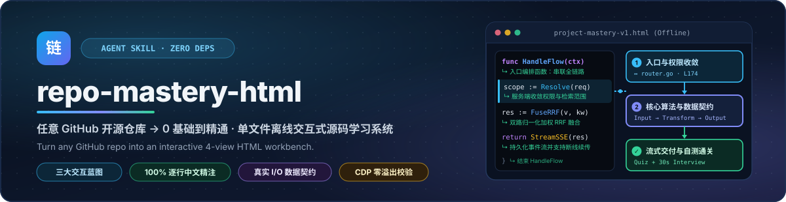
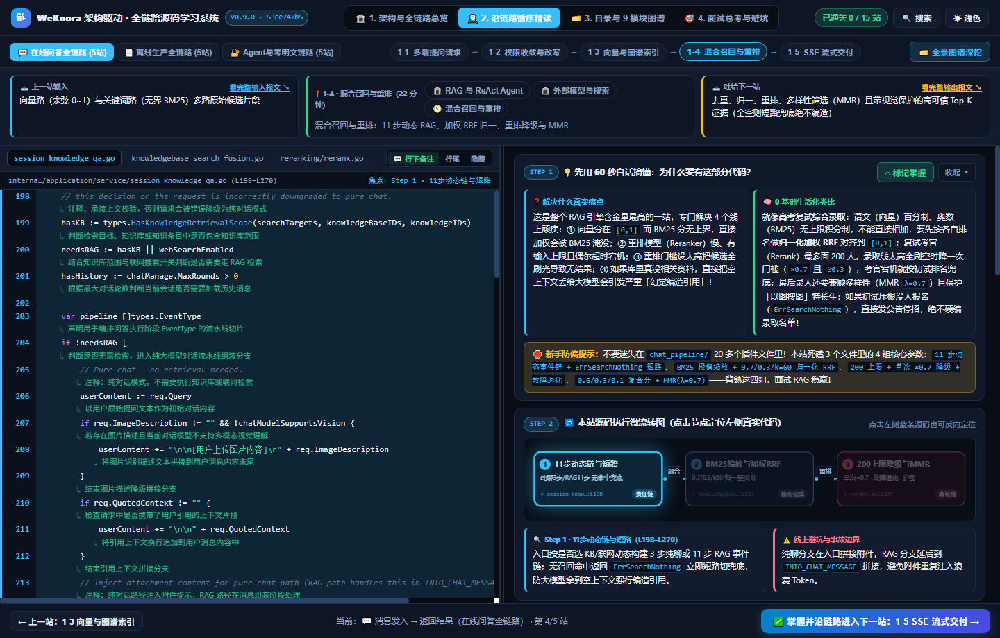
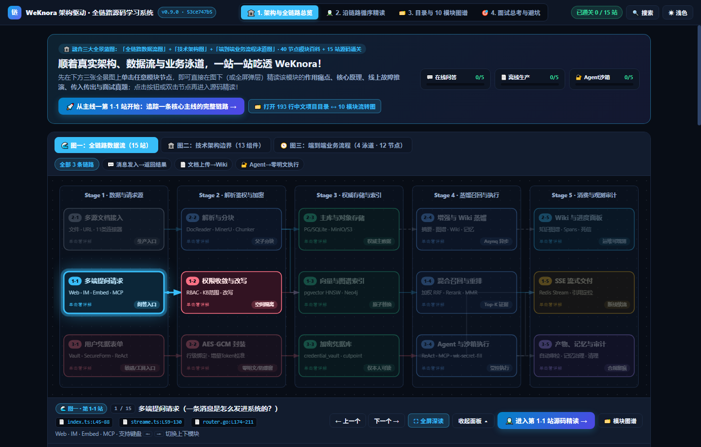
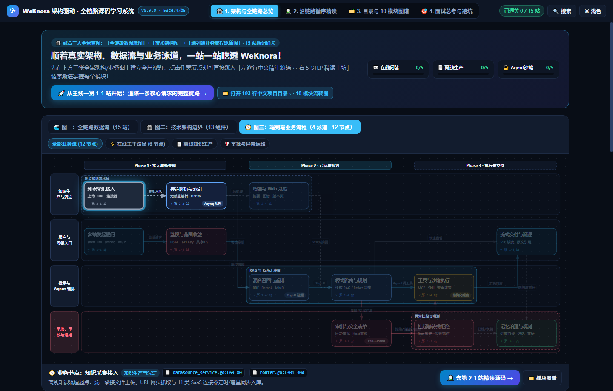
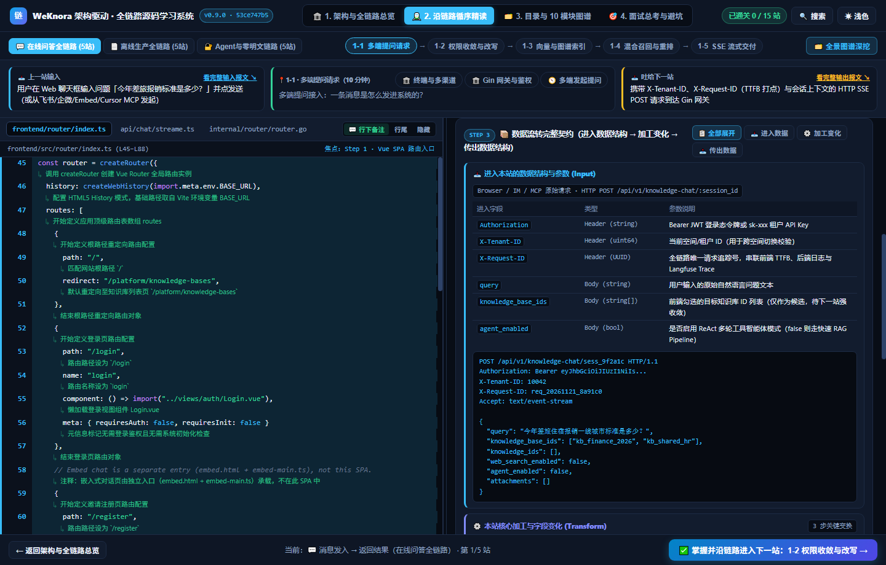
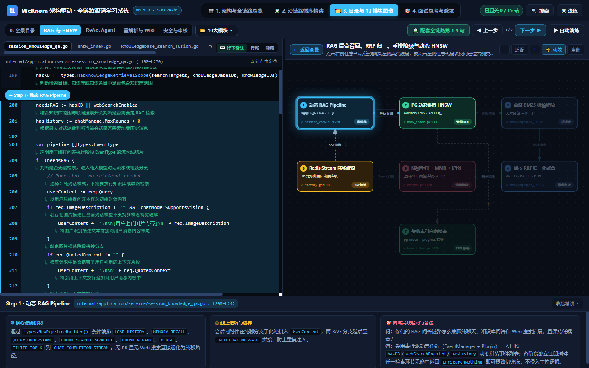
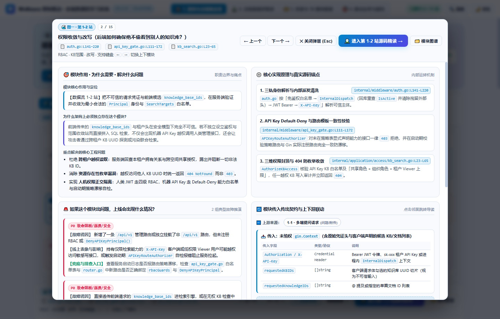

<div align="center">

<picture>
  <source media="(prefers-color-scheme: dark)" srcset="./docs/assets/banner-dark.svg" />
  <source media="(prefers-color-scheme: light)" srcset="./docs/assets/banner-light.svg" />
  
</picture>

<br />

<p>
  <a href="./README.md">简体中文</a> &nbsp;|&nbsp; <b>English</b>
</p>

<p>
  <a href="https://github.com/Frank-zhu2000/repo-mastery-html/stargazers">
    
  </a>
  <a href="./LICENSE">
    
  </a>
  = 20" />
  
  
</p>

<p>
  <b>🎮 <a href="https://frank-zhu2000.github.io/repo-mastery-html/">Live Online Demo</a></b>
  &nbsp;&nbsp;·&nbsp;&nbsp;
  <a href="#-showcase">Showcase</a>
  &nbsp;&nbsp;·&nbsp;&nbsp;
  <a href="#-why-repo-mastery-html">Why This Skill</a>
  &nbsp;&nbsp;·&nbsp;&nbsp;
  <a href="#-30-second-quick-start">Quick Start</a>
  &nbsp;&nbsp;·&nbsp;&nbsp;
  <a href="#-4-interactive-views--10-core-capabilities">Features</a>
  &nbsp;&nbsp;·&nbsp;&nbsp;
  <a href="#-%EF%B8%8F-7-phase-pipeline--cli">Pipeline & CLI</a>
</p>

</div>

---

## ✨ Showcase

> **Try it zero-install in your browser**: [**🎮 Open Live Interactive Demo**](https://frank-zhu2000.github.io/repo-mastery-html/) — a real single-file offline HTML workbench generated automatically from [`Tencent/WeKnora`](https://github.com/Tencent/WeKnora). Note: the built-in interactive study notes and per-line annotations are crafted in Simplified Chinese (`zh-CN`).

<div align="center">
  
  <p><sub><b>Flagship View · Station-by-Station Studio:</b> Verbatim source code with 100% per-line annotations on the left (below / inline / hidden toggles) ↔ STEP 1 Pain Point + Intuition Analogy + STEP 2 Interactive Micro-Flow & Pitfalls on the right.</sub></p>
</div>

<table>
  <tr>
    <td width="50%" align="center">
      
      <br />
      <sub><b>Map 1 · Full-Chain Dataflow Grid</b><br />Stage × Flow lanes with single-track focus, completion badges & I/O preview</sub>
    </td>
    <td width="50%" align="center">
      
      <br />
      <sub><b>Map 3 · End-to-End Business Swimlanes</b><br />Phases × Swimlanes × Groups with multi-track filters & multi-view jump buttons</sub>
    </td>
  </tr>
  <tr>
    <td width="50%" align="center">
      
      <br />
      <sub><b>STEP 3 · Concrete I/O Data Contracts</b><br />Entering struct/parameter tables → core transforms → exiting schema & JSON payloads</sub>
    </td>
    <td width="50%" align="center">
      
      <br />
      <sub><b>View 3 · Directory Tree ↔ Module Flows</b><br />Full annotated project directory tree linked 1-to-1 with zoomable drill-down diagrams</sub>
    </td>
  </tr>
</table>

<details>
<summary>🌞 Expand to preview Light Theme mode (one-click Dark / Light toggle inside the HTML)</summary>
<br />
<div align="center">
  
</div>
</details>

---

## 💡 Why `repo-mastery-html`?

| Dimension | Manual Code Reading | Generic AI Chat Summary | **`repo-mastery-html`** |
| :--- | :--- | :--- | :--- |
| **Big-Picture Orientation** | Easy to get lost in thousands of files | Static bullet lists or disconnected prose | **3 Interactive Overview Blueprints** (Dataflow + Tech Architecture + Business Swimlanes) jumping straight to source stations |
| **Line-by-Line Clarity** | Sparse comments, missing context | High-level handwaving disconnected from real lines | **100% Per-Line Source Annotations** (`MISSING=0` build gate, covering comments & closing braces too) |
| **Data Structures & I/O** | Must mentally trace struct mutations | Usually omits concrete payloads & parameter tables | **Dedicated I/O Contract per Station**: typed field tables + transformation steps + concrete JSON/HTTP/SQL payloads |
| **Source Authenticity** | Slow manual cross-referencing | AI often hallucinates line numbers or symbols | **Verbatim slicing at build time** — out-of-range slices or missing line notes fail the build immediately |
| **Retention & Interviews** | Quickly forgotten after reading | Zero active recall or progress tracking | Built-in **quizzes with completion sync + 3-min interview teleprompter + skip guide + `Ctrl+K` search** |
| **Visual QA** | N/A | Diagrams frequently clip or overlap labels | Zero-dep **Headless Edge/Chrome CDP verification** asserting `0` SVG `getBBox()` collisions + screenshot audit |

---

## 🚀 30-Second Quick Start

### 1. One-Line Global Install (Recommended)

```bash
npx skills@latest add Frank-zhu2000/repo-mastery-html -g
```

<details>
<summary>📦 Alternative: Manual git clone for your Agent CLI</summary>

```bash
# Antigravity (global)
git clone https://github.com/Frank-zhu2000/repo-mastery-html.git ~/.gemini/config/skills/repo-mastery-html

# Claude Code (global)
git clone https://github.com/Frank-zhu2000/repo-mastery-html.git ~/.claude/skills/repo-mastery-html

# Codex (global)
git clone https://github.com/Frank-zhu2000/repo-mastery-html.git ~/.agents/skills/repo-mastery-html

# Gemini CLI (global)
git clone https://github.com/Frank-zhu2000/repo-mastery-html.git ~/.gemini/skills/repo-mastery-html
```

</details>

### 2. Trigger with One Natural-Language Prompt

Once installed, simply ask your AI coding agent:

- **Analyze any GitHub repository**:
  > "Use the `repo-mastery-html` skill to generate an interactive zero-to-mastery HTML learning system for `https://github.com/langgenius/dify`."
- **Analyze your current local workspace**:
  > "Use `repo-mastery-html` to build a full-chain interactive source-code learning HTML for the current repository."

---

## 🎯 4 Interactive Views · 10 Core Capabilities

| View | Modules | Interactive Experience |
| :--- | :--- | :--- |
| **🏛️ View 1<br />Architecture & Flows** | **3 Interactive Blueprints + Progressive Syllabus** | **Map 1** (`Stage × Flow` dataflow + focus filter) · **Map 2** (components × dashed boundaries + upstream/downstream highlight) · **Map 3** (business swimlanes + multi-track filter + primary/secondary station jumps) + syllabus table |
| **🚆 View 2<br />Station-by-Station Studio** | **Metro Progress Bar + 5-STEP Studio + 100% Per-Line Notes** | Context bar → **STEP 1** (Pain Point + Analogy + Anti-Rabbit-Hole Tip) → **STEP 2** (Code ↔ Micro-Flow bidirectional sync + Pitfalls) → **STEP 3** (I/O Contracts & Payloads) → **STEP 4** (Quiz) → **STEP 5** (30s Interview Pitch) |
| **🗂️ View 3<br />Directory & Module Maps** | **Annotated Directory Tree ↔ 1-to-1 Drill-Down Diagrams** | Filterable, copyable project tree ↔ overview cards that drill down into zoomable, pannable, animated sub-flow diagrams paired with Flow Stations |
| **🎯 View 4 & Global** | **Interview Exam · `Ctrl+K` Search · Dual Themes · Non-Overwrite** | 3-min structured pitch + peripheral skip guide + mastery exam; **11+ language syntax highlighting**, 3 annotation display modes, Dark/Light themes & version-safe output |

---

## ⚙️ 7-Phase Pipeline & CLI

```mermaid
flowchart LR
    S0["0. Version Guard<br/>Preserve prior HTML versions"] --> S1["1. scan<br/>Local scan or shallow clone"]
    S1 --> S2["2. Blueprint Design<br/>3 maps + adaptive station scale"]
    S2 --> S3["3. curriculum.json<br/>5-STEP + concrete I/O contracts"]
    S3 --> S4["4. prepare-notes<br/>Balanced batches + parallel annotators"]
    S4 --> S5["5. verify-notes<br/>Enforce MISSING=0 coverage"]
    S5 --> S6["6. build<br/>Hydrate verbatim code to single HTML"]
    S6 --> S7["7. verify-html<br/>Headless CDP 0-overflow + screenshots"]
```



### Run the Zero-Dependency 5-Command CLI Directly (`Node.js >= 20`)

```bash
# 1. Scan a local workspace or shallow-clone a GitHub URL into scan.json
node scripts/repo_mastery_cli.mjs scan --github https://github.com/owner/repo --clone-dir ./repo --output ./out/scan.json

# 2. Deduplicate code slices from curriculum.json into balanced annotation batches
node scripts/repo_mastery_cli.mjs prepare-notes --repo ./repo --curriculum ./out/curriculum.json --out-dir ./out/work --batches 8

# 3. Verify 100% non-empty source line annotation coverage (exits non-zero if MISSING > 0)
node scripts/repo_mastery_cli.mjs verify-notes --repo ./repo --curriculum ./out/curriculum.json --annotations-dir ./out/annotations --output ./out/notes_report.json

# 4. Build standalone offline HTML with verbatim source hydration & overwrite guard
node scripts/repo_mastery_cli.mjs build --repo ./repo --curriculum ./out/curriculum.json --annotations-dir ./out/annotations --output ./out/project-mastery-v1.html

# 5. Run Headless Edge/Chrome CDP verification (0 console errors, 0 SVG overflow) & capture 6 screenshots
node scripts/repo_mastery_cli.mjs verify-html --html ./out/project-mastery-v1.html --shots-dir ./out/screenshots --port 9345 --output ./out/cdp_report.json
```

---

## 📁 Project Structure

```text
repo-mastery-html/
├── SKILL.md                                # Agent Skill instruction manual (7-phase workflow)
├── README.md                               # 简体中文主说明文档
├── README.en.md                            # Full English Documentation
├── LICENSE                                 # MIT License
├── docs/
│   ├── index.html                          # Live Interactive Demo served on GitHub Pages
│   ├── .nojekyll                           # Bypass Jekyll so standalone HTML serves cleanly
│   └── assets/                             # Adaptive Dark/Light SVG banners & 6 showcase PNGs
├── scripts/
│   ├── repo_mastery_cli.mjs                # Zero-dependency 5-command CLI
│   └── render_template.mjs                 # Generic single-file HTML renderer (11+ languages)
├── references/
│   ├── schema_spec.md                      # Complete curriculum.json schema & SVG width guardrails
│   ├── v5_parity_checklist.md              # Zero-omission 10-pillar acceptance checklist
│   └── annotator_prompt.md                 # Parallel code_annotator subagent protocol
└── examples/
    └── minimal_curriculum.example.json     # Minimal runnable curriculum reference example
```

---

## Requirements

- **Node.js `>= 20`**: uses built-in `fetch` and `WebSocket` (zero npm dependencies)
- **Git**: used by `scan --github` shallow clone and commit metadata extraction
- **Microsoft Edge or Google Chrome**: required only when running `verify-html` automated CDP checks; the generated `.html` output runs 100% offline in any modern browser

## License

[MIT](./LICENSE)
