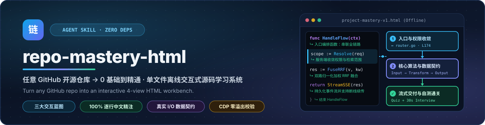
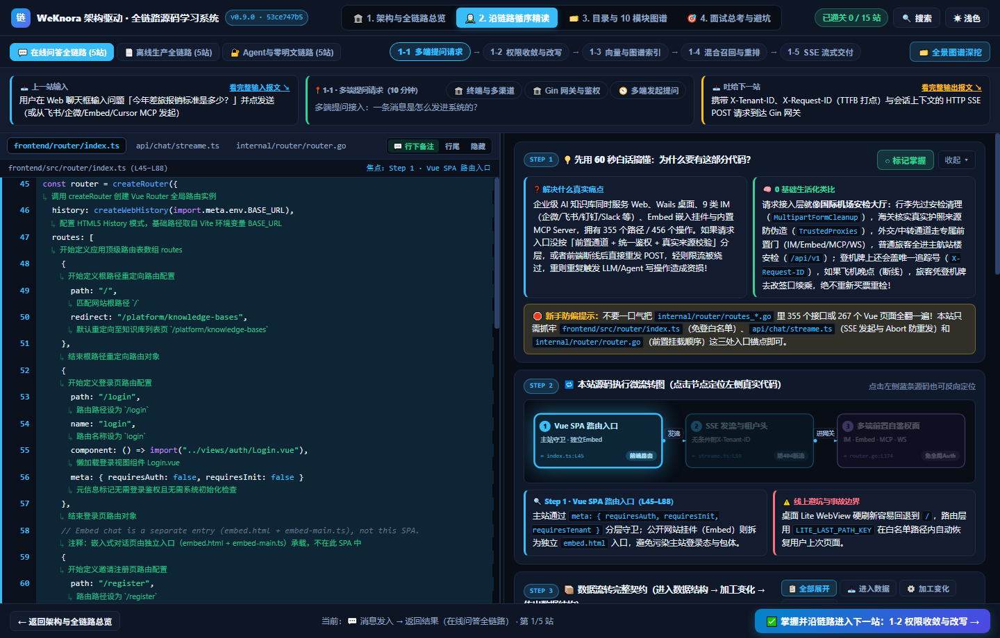
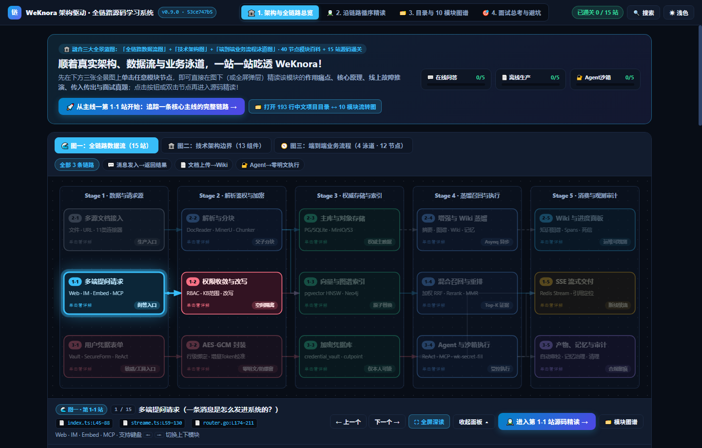
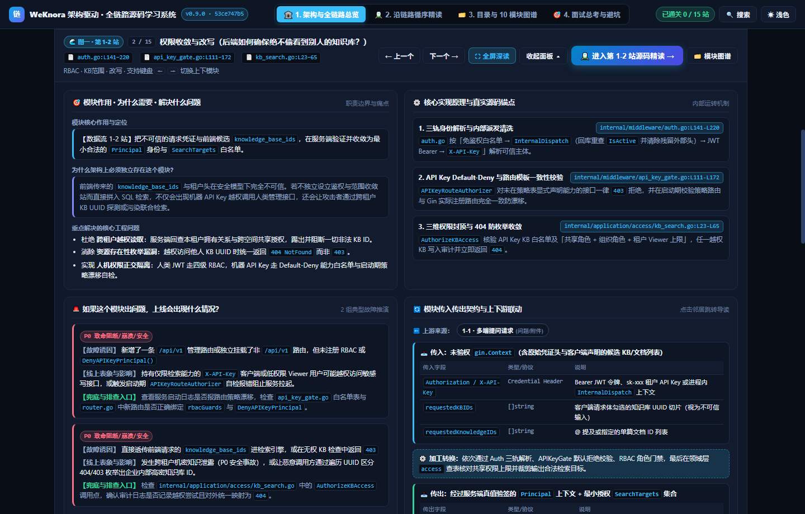
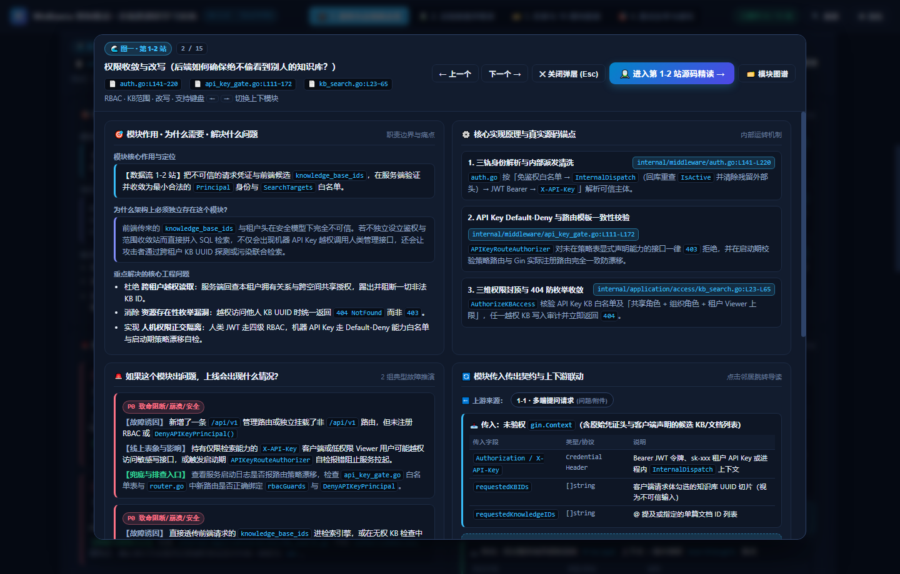
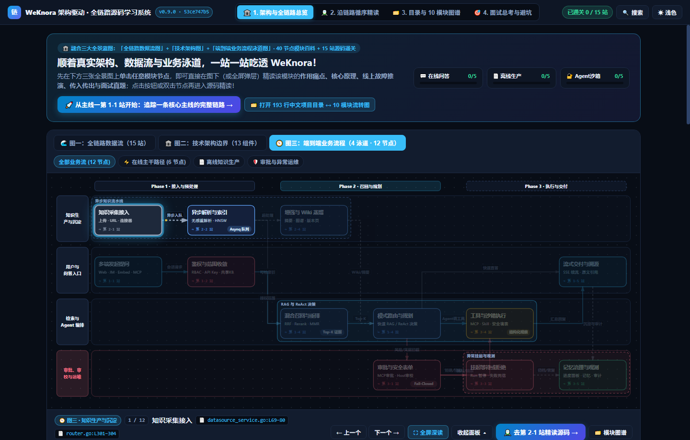
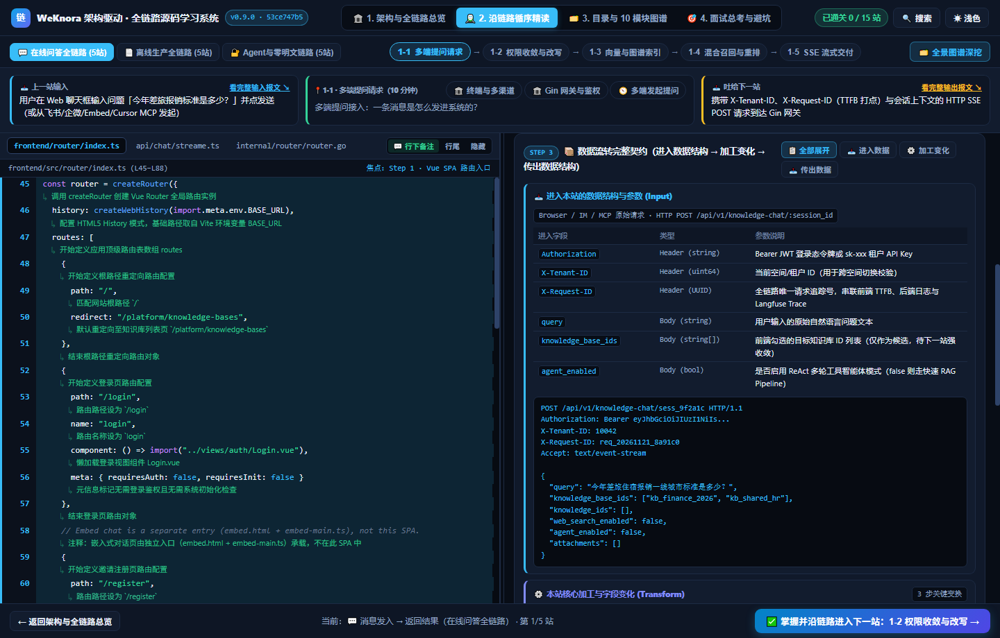
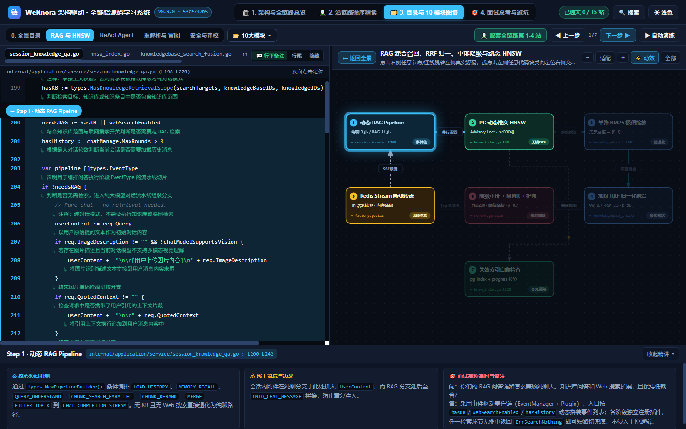
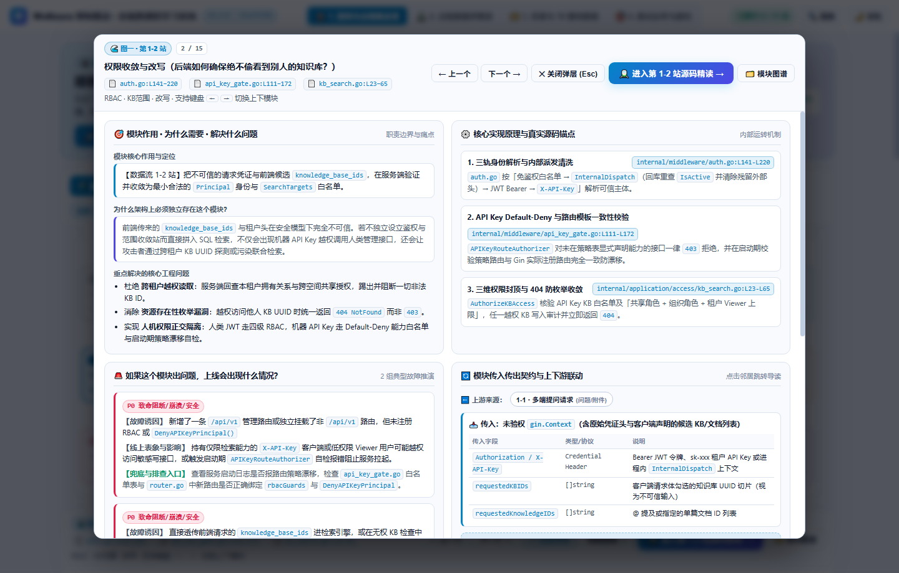
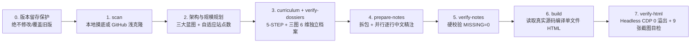

<div align="center">

<picture>
  <source media="(prefers-color-scheme: dark)" srcset="./docs/assets/banner-dark.svg" />
  <source media="(prefers-color-scheme: light)" srcset="./docs/assets/banner-light.svg" />
  
</picture>

<br />

<p>
  <b>简体中文</b> &nbsp;|&nbsp; <a href="./README.en.md">English</a>
</p>

<p>
  <a href="https://github.com/Frank-zhu2000/repo-mastery-html/actions/workflows/ci.yml">
    
  </a>
  <a href="https://github.com/Frank-zhu2000/repo-mastery-html/stargazers">
    
  </a>
  <a href="./LICENSE">
    
  </a>
  = 20" />
  
  
</p>

<p>
  <b>🎮 <a href="https://frank-zhu2000.github.io/repo-mastery-html/">在线体验 Demo</a></b>
  &nbsp;&nbsp;·&nbsp;&nbsp;
  <a href="#-效果演示">效果演示</a>
  &nbsp;&nbsp;·&nbsp;&nbsp;
  <a href="#-为什么选择-repo-mastery-html">核心对比</a>
  &nbsp;&nbsp;·&nbsp;&nbsp;
  <a href="#-30-秒极速安装与使用">极速安装</a>
  &nbsp;&nbsp;·&nbsp;&nbsp;
  <a href="#-四大视图--11-大内置能力">四大视图</a>
  &nbsp;&nbsp;·&nbsp;&nbsp;
  <a href="#-%EF%B8%8F-7-阶段端到端流水线--cli">工作流 & CLI</a>
</p>

</div>

---

## ✨ 效果演示

> **零安装直接试玩**：[**🎮 点击打开 GitHub Pages 在线交互 Demo**](https://frank-zhu2000.github.io/repo-mastery-html/) —— 以开源项目 [`Tencent/WeKnora`](https://github.com/Tencent/WeKnora) 为实景案例生成，展示本 Skill 对任意 GitHub/本地开源仓库（支持 **Web 后端 / 前端框架 / CLI 编译器 / SDK 与 AI 引擎** 等 4 类架构原型及 **18+ 编程语言**）生成的单文件离线 HTML 效果。

<div align="center">
  
  <p><sub><b>旗舰视图 · 沿链路循序精读：</b>左栏真实源码 100% 逐行中文精注（行下/行尾/隐藏一键切换）↔ 右栏 STEP 1 痛点与 0 基础类比 + STEP 2 微流转图双向高亮 + 线上避坑指南。</sub></p>
</div>

<table>
  <tr>
    <td width="50%" align="center">
      
      <br />
      <sub><b>图一 · 全链路数据流转与节点联动</b><br />Stage × 主线网格，支持单链聚焦、选中节点上下游连线高亮、无关淡化与绿灯通关同步</sub>
    </td>
    <td width="50%" align="center">
      
      <br />
      <sub><b>View 1 · 图下常驻 6 维深度导读</b><br />2 列可收起导读面板：作用/原理/源码锚点 + P0/P1 故障推演 + 上下游胶囊跳转 + 面试题自测</sub>
    </td>
  </tr>
  <tr>
    <td width="50%" align="center">
      
      <br />
      <sub><b>View 1 · 一键全屏深读弹层</b><br />支持 `←/→` 键盘与按钮无跳页漫游、面试题答案一键展开/折叠、`Esc` 退出弹层</sub>
    </td>
    <td width="50%" align="center">
      
      <br />
      <sub><b>图三 · 端到端业务流程泳道图</b><br />阶段 × 业务泳道 × SLA 故障视角，支持多轨筛选与主/次站点与模块图谱跳转</sub>
    </td>
  </tr>
  <tr>
    <td width="50%" align="center">
      
      <br />
      <sub><b>STEP 3 · 数据流转完整契约</b><br />真实 Entering 结构/参数表 → 核心加工变化 → Exiting 输出结构与真实样例</sub>
    </td>
    <td width="50%" align="center">
      
      <br />
      <sub><b>视图 3 · 全中文目录树 ↔ 模块流程图</b><br />完整中文注释目录树 1-to-1 下钻模块流程图，双向精准滚动定位</sub>
    </td>
  </tr>
</table>

<details>
<summary>🌞 点击展开：查看浅色主题 v6 全屏深读实拍效果（支持一键深浅色切换）</summary>
<br />
<div align="center">
  
</div>
</details>

---

## 💡 为什么选择 repo-mastery-html？

| 维度 | 传统手啃源码 | 普通 AI 对话总结 | **repo-mastery-html** |
| :--- | :--- | :--- | :--- |
| **全景视野** | 动辄数千文件，极易迷失在目录里 | 只给静态文字列表或零散片段 | **三张交互全景蓝图**（数据流 + 技术架构 + 业务泳道）+**全节点 6 维独立导读百科**（双形态图下展开/全屏弹层、线上 P0/P1 故障推演与上下游胶囊漫游） |
| **逐行理解** | 缺少中文注释，看不懂业务上下文 | 泛泛解释函数名，源码行对不上 | **100% 非空源码行中文精注**（含原注释翻译与 `}` 结构结束说明） |
| **数据流与参数** | 参数怎么流转、在哪改字段全靠脑补 | 往往省略真实结构体与报文示例 | **每站独立 I/O 数据契约**：完整参数表 + 核心加工步骤 + 真实 JSON/HTTP/SQL 样例 |
| **源码真实性** | 自己翻太慢 | AI 容易“幻觉”编造函数与行号 | **构建期从仓库逐字读取切片**，行号越界或缺少注释直接阻断构建 |
| **复习与面试转化** | 看完后忘，难以系统复述给面试官 | 无进度追踪与交互自测 | 内置 **4 选 1 闯关绿灯 + 3 分钟面试提词器 + 红黑榜 + 结业总考 + `Ctrl+K` 检索** |
| **视觉与排版验收** | 无 | 生成的 Mermaid/SVG 常重叠截断 | 零依赖 **Headless Edge/Chrome CDP 校验**，强制 `0` SVG 碰撞溢出并出图目检 |

---

## 🚀 30 秒极速安装与使用

### 1. 一行命令全局安装（推荐）

```bash
npx skills@latest add Frank-zhu2000/repo-mastery-html -g
```

<details>
<summary>📦 备选方式：按 Agent 客户端手动 git clone 安装</summary>

```bash
# Antigravity (全局)
git clone https://github.com/Frank-zhu2000/repo-mastery-html.git ~/.gemini/config/skills/repo-mastery-html

# Claude Code (全局)
git clone https://github.com/Frank-zhu2000/repo-mastery-html.git ~/.claude/skills/repo-mastery-html

# Codex (全局)
git clone https://github.com/Frank-zhu2000/repo-mastery-html.git ~/.agents/skills/repo-mastery-html

# Gemini CLI (全局)
git clone https://github.com/Frank-zhu2000/repo-mastery-html.git ~/.gemini/skills/repo-mastery-html
```

</details>

### 2. 对 AI Agent 一句话触发

安装完成后，在任意对话中直接下达指令即可自动完成「克隆扫描 → 蓝图设计 → 逐行精注 → 构建与 CDP 验收」：

- **分析 GitHub 开源仓库**：
  > “用 `repo-mastery-html` 这个 skill，帮我为 `https://github.com/langgenius/dify` 生成一套从 0 基础到精通的交互式源码学习 HTML。”
- **分析当前本地项目**：
  > “用 `repo-mastery-html` 为当前工作区项目制作一套全链路交互式源码学习 HTML。”

---

## 🎯 四大视图 · 11 大内置能力

| 视图 | 核心模块 | 关键交互与学习体验 |
| :--- | :--- | :--- |
| **🏛️ 视图 1<br />架构与全链路总览** | **三大全景交互蓝图 + 全节点 6 维导读 + 渐进大纲** | **图一**（`Stage × 主线` 数据流 + 上下游连线高亮 + 主线筛选 + 绿灯同步）· **图二**（组件 × 虚线边界 + 爆炸半径视角）· **图三**（业务泳道 × SLA 故障视角）+ **双形态导读面板（可收起 2 列卡 + `⛶ 全屏深读` 居中弹层）**，单击看详解防误触、双击/CTA 进源码、`←/→` 键盘与上下游胶囊漫游 + 面试题折叠自测 |
| **🚆 视图 2<br />沿链路循序精读** | **地铁进度条 + 5-STEP 学习工坊 + 100% 逐行中文源码** | 顶部输入/输出上下文条 → **STEP 1**（痛点 + 0 基础类比 + 防偏提示）→ **STEP 2**（左源码 ↔ 右微流转图双向点击 + 避坑）→ **STEP 3**（I/O 参数表与真实报文）→ **STEP 4**（闯关自测）→ **STEP 5**（面试 30 秒口述） |
| **🗂️ 视图 3<br />目录与模块图谱** | **全中文目录树 ↔ 模块 1-to-1 下钻流程图** | 左侧完整中文备注目录树（实时过滤 + 复制）↔ 右侧模块卡片点击下钻专属流程图，支持拖拽平移、滚轮缩放、流向动效、自动演练与全链路回跳 |
| **🎯 视图 4 & 全局** | **面试总考 · `Ctrl+K` 检索 · 双主题 · 防覆盖保护** | 3 分钟 4 段式提词器 + 外围胶水红黑榜 + 结业总考；内置 **`Ctrl+K` 全域搜索（含图二组件与高频考点）**、**18+ 语言语法高亮与 `plain` 回退**、`💬 行下 / 行尾 / 隐藏` 三态备注、深浅色切换与版本留存防覆盖 |

---

## ⚙️ 7 阶段端到端流水线 & CLI



### 手动运行 6 命令 CLI（Node.js `>= 20`，零 npm 依赖）

```bash
# 1. 扫描本地仓库或浅克隆 GitHub URL -> 生成 scan.json
node scripts/repo_mastery_cli.mjs scan --github https://github.com/owner/repo --clone-dir ./repo --output ./out/scan.json

# 2. 校验 View 1 三图全节点 6 维独立档案（支持内联或 --dossiers-dir 三图拆分，强校验 role 全局唯一）
node scripts/repo_mastery_cli.mjs verify-dossiers --curriculum ./out/curriculum.json --dossiers-dir ./out/dossiers --output ./out/dossiers_report.json

# 3. 按 curriculum.json 真实切片去重并拆分为 N 个均衡批次
node scripts/repo_mastery_cli.mjs prepare-notes --repo ./repo --curriculum ./out/curriculum.json --out-dir ./out/work --batches 8

# 4. 合并并严格校验 100% 非空源码行中文备注覆盖（MISSING=0 方可通过）
node scripts/repo_mastery_cli.mjs verify-notes --repo ./repo --curriculum ./out/curriculum.json --annotations-dir ./out/annotations --output ./out/notes_report.json

# 5. 读取真实源码编译单文件离线 HTML（内置防覆盖保护；支持 --dossiers-dir 合并或 --allow-legacy-overview 兼容旧版）
node scripts/repo_mastery_cli.mjs build --repo ./repo --curriculum ./out/curriculum.json --dossiers-dir ./out/dossiers --annotations-dir ./out/annotations --output ./out/project-mastery-v1.html

# 6. Headless Edge/Chrome CDP 自动化 0 溢出校验 + v6 交互断言 + 9 张深浅色截图采集
node scripts/repo_mastery_cli.mjs verify-html --html ./out/project-mastery-v1.html --shots-dir ./out/screenshots --port 9345 --output ./out/cdp_report.json
```

---

## 📁 项目结构

```text
repo-mastery-html/
├── SKILL.md                                # 核心 Agent Skill 手册（7 阶段端到端流水线）
├── README.md                               # 简体中文主说明文档
├── README.en.md                            # Full English Documentation
├── LICENSE                                 # MIT 开源协议
├── .github/workflows/ci.yml                # GitHub Actions 自动化冒烟与 Headless CDP CI
├── docs/
│   ├── index.html                          # GitHub Pages 在线可交互 Demo
│   ├── .nojekyll                           # 禁用 Jekyll，直出静态单文件 HTML
│   └── assets/                             # 自适应深浅色矢量 Banner 与实拍演示图
├── scripts/
│   ├── repo_mastery_cli.mjs                # 零依赖 6 命令 CLI（scan/verify-dossiers/prepare-notes/verify-notes/build/verify-html）
│   └── render_template.mjs                 # 通用化单文件 HTML 渲染引擎（v6 全景导读 + 18+ 语言 + plain 回退，自适应规模）
├── references/
│   ├── schema_spec.md                      # curriculum.json、overviewDossiers 与 4 类开源原型映射规范
│   ├── v6_parity_checklist.md              # 零遗漏 11 大支柱验收清单
│   ├── dossier_author_prompt.md            # 并行 3 路 dossier_author 子代理视角编写规范
│   └── annotator_prompt.md                 # 并行 code_annotator 子代理逐行中文注释规范
├── examples/
│   └── minimal_curriculum.example.json     # 含完整 3 站 + 9 档案的最小可运行 Schema 参考示例
└── tests/
    └── smoke_test.mjs                      # 零依赖端到端冒烟与 CDP 回归测试套件
```

---

## 环境要求

- **Node.js `>= 20`**：使用原生 `fetch` 与 `WebSocket`，无需 `npm install`
- **Git**：用于 `--github` 浅克隆与仓库 commit 元信息提取
- **Microsoft Edge / Google Chrome**：仅运行 `verify-html` Headless CDP 自动校验时需要；生成后的最终 `.html` 产物纯离线双击即可打开

## License

[MIT](./LICENSE)
